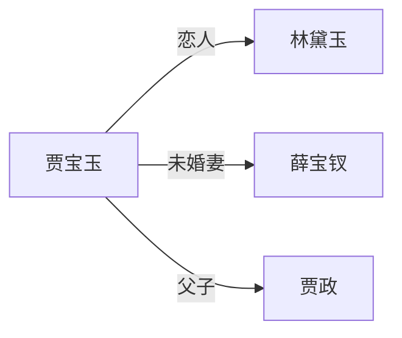

# Story Wiki 项目总体规划

> 项目愿景：AI 驱动的故事创作与知识库系统
> 规划时间：2026-06-22
> 当前版本：v0.6.0（长文本处理优化完成）

---

## 🎯 项目愿景

**一句话描述：** 输入任何小说或事件，AI 自动分析并生成结构化知识库，然后基于知识库驱动 AI 创作新小说。

**核心价值：**
1. **分析能力**：从任意文本中提取人物、设定、事件、关系
2. **可视化能力**：在 Obsidian 中查看关系图谱，不同实体类型不同颜色
3. **创作能力**：基于知识库驱动 AI 创作新小说，支持番茄小说等平台发布

---

## 📊 项目阶段划分

### 阶段 1：AI 分析与卡片生成 ✅ 已完成
**目标：** 输入文本 → AI 分析 → 生成 Obsidian 笔记

**已完成功能：**
- ✅ 文本提取（txt/epub/pdf）
- ✅ 智能章节切分（按标题/按字数）
- ✅ AI 分析（人物、设定、事件、关系）
- ✅ Obsidian 笔记生成（人物卡、设定卡、事件卡）
- ✅ 关系图谱可视化（Mermaid）
- ✅ 增量分析（追加新章节不覆盖）
- ✅ 长文本优化（80万字+支持）

**当前状态：** 100% 完成

---

### 阶段 2：关系图谱增强 🔧 开发中
**目标：** 增强关系图谱的可视化效果，支持多类型实体颜色区分

**待实现功能：**
- [ ] Obsidian 插件配置（自定义节点颜色）
- [ ] 人物节点：蓝色
- [ ] 事件节点：橙色
- [ ] 设定节点：绿色
- [ ] 关系边：灰色（可选按关系类型着色）
- [ ] 图谱布局优化（力导向布局参数）
- [ ] 图谱交互增强（点击节点显示详情）
- [ ] 图谱导出功能（PNG/SVG）

**实现方案：**
```
1. 在 Vault 根目录创建 .obsidian/plugins/graph-colors/ 目录
2. 配置 manifest.json 和 main.js
3. 在 frontmatter 中添加 color 字段
4. 配置 Graph View 的节点颜色映射
```

**预计时间：** 1-2 周

---

### 阶段 3：小说 Agent 核心 🚀 规划中
**目标：** 基于 Obsidian 知识库驱动 AI 创作新小说

**核心设计：** 混合驱动模式
1. **情节框架驱动**：先生成情节大纲（起承转合），然后逐章填充内容
2. **角色扮演驱动**：Agent 扮演主角，基于人物卡片的性格、动机自动决策和行动
3. **自由探索驱动**：Agent 基于世界观设定自由探索，产生意外情节

#### 3.1 知识库读取模块（新增）

**功能：** 从 Obsidian Vault 读取知识库内容

**输入：**
- 人物卡片（身份、性格、关系、语录）
- 设定卡片（世界观、地点、组织）
- 事件卡片（时间线、因果关系）

**输出：**
```python
{
    "characters": [
        {
            "name": "贾宝玉",
            "personality": "叛逆、多情",
            "motivation": "追求真爱，反抗封建礼教",
            "relationships": [...],
            "current_state": "活跃"
        }
    ],
    "settings": [...],
    "events": [...],
    "world_rules": "...",
    "timeline": [...]
}
```

#### 3.2 情节生成模块（新增）

**功能：** 基于知识库生成情节大纲

**流程：**
1. 分析现有事件的时间线
2. 识别情节空白（可以填充新事件的地方）
3. 生成情节大纲（起承转合）
4. 人工审核确认

**Prompt 设计：**
```
你是一个专业的小说情节设计师。基于以下知识库，生成一个新的情节大纲：

【人物】
{人物列表和性格}

【世界观】
{设定和规则}

【已有事件】
{时间线和因果关系}

请生成：
1. 情节主题（一句话）
2. 冲突点（核心矛盾）
3. 起承转合（4个阶段）
4. 关键转折点
5. 结局方向
```

#### 3.3 章节生成模块（新增）

**功能：** 基于情节大纲逐章生成小说内容

**流程：**
1. 加载情节大纲
2. 加载相关人物卡片
3. 生成章节内容
4. 更新知识库（新事件、人物状态变化）
5. 保存日志（即小说内容）

**质量控制：** 混合模式
- AI 自动检查逻辑一致性、人物性格一致性
- 关键节点（章节开头、高潮、结尾）人工确认

#### 3.4 知识库更新模块（新增）

**功能：** 小说生成过程中自动更新 Obsidian 知识库

**更新内容：**
- 新事件卡片
- 人物状态变化
- 新设定补充
- 关系变化

#### 3.5 日志记录模块（新增）

**功能：** 记录小说生成过程，输出最终小说

**输出格式：** 渐进式更新
- 每章写完自动保存
- 支持断点续写
- 最终合并为完整小说

**文件结构：**
```
novels/
├── {作品名}/
│   ├── outline.md              # 情节大纲
│   ├── chapters/
│   │   ├── chapter_001.md      # 第1章
│   │   ├── chapter_002.md      # 第2章
│   │   └── ...
│   ├── characters_update.md    # 人物状态变化日志
│   ├── events_update.md        # 新增事件日志
│   └── final_novel.txt         # 最终合并的小说
```

**预计时间：** 4-6 周

---

### 阶段 4：商业化准备 📈 规划中
**目标：** 支持番茄小说等平台发布

#### 4.1 格式转换模块（新增）

**功能：** 将生成的小说转换为平台要求的格式

**支持平台：**
- 番茄小说（纯文本章节）
- 起点中文网（纯文本章节）
- 晋江文学城（纯文本章节）
- 通用 EPUB 格式

**格式要求：**
- 章节标题：第X章 标题
- 段落格式：首行缩进2字符
- 字数要求：每章 2000-3000 字
- 更新频率：每日更新

#### 4.2 质量检测模块（新增）

**功能：** 自动检测小说质量

**检测项目：**
- 逻辑一致性（人物行为是否符合性格）
- 时间线一致性（事件顺序是否合理）
- 字数统计（每章字数是否达标）
- 重复检测（避免重复内容）
- 敏感词检测（避免违规内容）

#### 4.3 批量生成模块（新增）

**功能：** 批量生成多章小说

**流程：**
1. 加载情节大纲
2. 循环生成每章
3. 自动保存和更新知识库
4. 生成更新日志

**预计时间：** 2-3 周

---

## 🏗️ 技术架构

### 整体架构

```
┌─────────────────────────────────────────────────────────────┐
│                      用户界面层                              │
│  main.py / agent.py / web_ui（未来）                         │
└─────────────────────────────────────────────────────────────┘
                              │
                              ▼
┌─────────────────────────────────────────────────────────────┐
│                      核心业务层                              │
│  ┌──────────────┐  ┌──────────────┐  ┌──────────────┐      │
│  │  分析引擎     │  │  创作引擎     │  │  知识库管理    │      │
│  │  analyzer.py  │  │  novel_writer.py│  │  vault_manager.py│  │
│  └──────────────┘  └──────────────┘  └──────────────┘      │
└─────────────────────────────────────────────────────────────┘
                              │
                              ▼
┌─────────────────────────────────────────────────────────────┐
│                      基础设施层                              │
│  ┌──────────────┐  ┌──────────────┐  ┌──────────────┐      │
│  │  文本处理     │  │  AI 调用      │  │  文件系统     │      │
│  │  extractor.py │  │  api_client.py│  │  file_utils.py│     │
│  │  splitter.py  │  │              │  │              │      │
│  └──────────────┘  └──────────────┘  └──────────────┘      │
└─────────────────────────────────────────────────────────────┘
                              │
                              ▼
┌─────────────────────────────────────────────────────────────┐
│                      数据存储层                              │
│  ┌──────────────┐  ┌──────────────┐  ┌──────────────┐      │
│  │  Obsidian     │  │  本地缓存     │  │  配置文件     │      │
│  │  Vault        │  │  cache/       │  │  .env        │      │
│  └──────────────┘  └──────────────┘  └──────────────┘      │
└─────────────────────────────────────────────────────────────┘
```

### 模块依赖关系

```
入口层 (main.py / agent.py)
    │
    ├── 分析引擎 (analyzer.py)
    │       │
    │       ├── 文本处理 (extractor.py + splitter.py)
    │       └── AI 调用 (api_client.py)
    │
    ├── 创作引擎 (novel_writer.py)  [新增]
    │       │
    │       ├── 知识库读取 (vault_manager.py)  [新增]
    │       ├── 情节生成 (plot_generator.py)  [新增]
    │       ├── 章节生成 (chapter_generator.py)  [新增]
    │       └── 日志记录 (logger.py)  [新增]
    │
    ├── 知识库管理 (vault_manager.py)  [新增]
    │       │
    │       ├── 读取卡片 (read_cards.py)
    │       ├── 更新卡片 (update_cards.py)
    │       └── 图谱配置 (graph_config.py)
    │
    └── 格式转换 (converter.py)  [新增]
            │
            ├── 番茄小说格式
            ├── 起点格式
            └── EPUB 格式
```

---

## 📁 新增文件规划

### 阶段 2 新增文件

```
story_wiki/
├── .obsidian/
│   └── plugins/
│       └── graph-colors/          # 图谱颜色插件
│           ├── manifest.json
│           ├── main.js
│           └── styles.css
└── docs/
    └── 02_功能设计/
        └── 关系图谱增强.md         # 设计文档
```

### 阶段 3 新增文件

```
story_wiki/
├── src/
│   ├── novel_writer.py            # 小说创作引擎（主控）
│   ├── vault_manager.py           # 知识库管理
│   ├── plot_generator.py          # 情节生成器
│   ├── chapter_generator.py       # 章节生成器
│   ├── knowledge_loader.py        # 知识库读取
│   └── novel_logger.py            # 日志记录器
├── novels/                        # 生成的小说目录
│   └── {作品名}/
│       ├── outline.md
│       ├── chapters/
│       └── final_novel.txt
└── docs/
    └── 02_功能设计/
        ├── 小说Agent设计.md
        ├── 情节生成模块.md
        └── 知识库管理模块.md
```

### 阶段 4 新增文件

```
story_wiki/
├── src/
│   ├── converter.py               # 格式转换器
│   ├── quality_checker.py         # 质量检测器
│   └── batch_generator.py         # 批量生成器
└── docs/
    └── 02_功能设计/
        ├── 商业化模块.md
        └── 格式转换模块.md
```

---

## 🗓️ 时间规划

### 阶段 2：关系图谱增强（1-2 周）

**第 1 周：**
- Day 1-2：研究 Obsidian Graph View 插件机制
- Day 3-4：实现图谱颜色配置
- Day 5-7：测试和优化

**第 2 周：**
- Day 1-3：实现图谱交互增强
- Day 4-5：实现图谱导出功能
- Day 6-7：文档和测试

**交付物：**
- ✅ 图谱颜色配置（人物蓝色、事件橙色、设定绿色）
- ✅ 图谱交互增强（点击节点显示详情）
- ✅ 图谱导出功能（PNG/SVG）
- ✅ 设计文档和使用说明

---

### 阶段 3：小说 Agent 核心（4-6 周）

**第 1-2 周：知识库读取和情节生成**
- Day 1-3：实现知识库读取模块
- Day 4-7：实现情节生成模块
- Day 8-10：测试和优化
- Day 11-14：文档编写

**第 3-4 周：章节生成和质量控制**
- Day 1-5：实现章节生成模块
- Day 6-7：实现质量检查模块
- Day 8-10：实现知识库更新模块
- Day 11-14：测试和优化

**第 5-6 周：日志记录和集成测试**
- Day 1-3：实现日志记录模块
- Day 4-7：集成测试
- Day 8-10：性能优化
- Day 11-14：文档和示例

**交付物：**
- ✅ 知识库读取模块
- ✅ 情节生成模块
- ✅ 章节生成模块
- ✅ 知识库更新模块
- ✅ 日志记录模块
- ✅ 质量控制模块
- ✅ 设计文档和使用说明
- ✅ 示例项目（基于红楼梦）

---

### 阶段 4：商业化准备（2-3 周）

**第 1 周：格式转换**
- Day 1-3：实现番茄小说格式转换
- Day 4-5：实现起点格式转换
- Day 6-7：实现 EPUB 格式转换

**第 2 周：质量检测**
- Day 1-3：实现逻辑一致性检测
- Day 4-5：实现时间线一致性检测
- Day 6-7：实现敏感词检测

**第 3 周：批量生成**
- Day 1-3：实现批量生成模块
- Day 4-5：实现断点续写功能
- Day 6-7：测试和文档

**交付物：**
- ✅ 格式转换模块（番茄/起点/EPUB）
- ✅ 质量检测模块
- ✅ 批量生成模块
- ✅ 设计文档和使用说明

---

## 💡 核心算法设计

### 1. 情节生成算法

**输入：**
- 人物卡片（性格、动机、关系）
- 设定卡片（世界观、规则）
- 事件卡片（时间线、因果关系）

**算法：**
```python
def generate_plot_outline(knowledge_base: dict) -> dict:
    """
    基于知识库生成情节大纲

    算法步骤：
    1. 分析现有事件的时间线
    2. 识别情节空白（可以填充新事件的地方）
    3. 分析人物动机和冲突
    4. 生成情节大纲（起承转合）
    5. 验证逻辑一致性
    """
    # 1. 时间线分析
    timeline = analyze_timeline(knowledge_base["events"])

    # 2. 空白识别
    gaps = identify_plot_gaps(timeline, knowledge_base)

    # 3. 冲突分析
    conflicts = analyze_conflicts(knowledge_base["characters"])

    # 4. 大纲生成
    outline = generate_outline(gaps, conflicts, knowledge_base)

    # 5. 一致性验证
    if validate_outline(outline, knowledge_base):
        return outline
    else:
        return regenerate_outline(outline, knowledge_base)
```

### 2. 章节生成算法

**输入：**
- 情节大纲
- 相关人物卡片
- 前文内容

**算法：**
```python
def generate_chapter(outline: dict, context: dict) -> str:
    """
    基于情节大纲生成章节内容

    算法步骤：
    1. 加载情节大纲
    2. 加载相关人物卡片
    3. 构建 prompt（包含人物性格、前文内容）
    4. 生成章节内容
    5. 质量检查
    6. 更新知识库
    """
    # 1. 加载上下文
    characters = load_characters(context["character_names"])

    # 2. 构建 prompt
    prompt = build_chapter_prompt(outline, characters, context["previous_content"])

    # 3. 生成内容
    chapter_content = call_ai(prompt)

    # 4. 质量检查
    if quality_check(chapter_content, characters):
        # 5. 更新知识库
        update_knowledge_base(chapter_content, characters)
        return chapter_content
    else:
        return regenerate_chapter(chapter_content, characters)
```

### 3. 质量控制算法

**检查项目：**
```python
def quality_check(chapter_content: str, characters: list) -> bool:
    """
    质量检查

    检查项目：
    1. 逻辑一致性：人物行为是否符合性格
    2. 时间线一致性：事件顺序是否合理
    3. 字数检查：每章字数是否达标
    4. 重复检测：避免重复内容
    """
    checks = [
        check_logic_consistency(chapter_content, characters),
        check_timeline_consistency(chapter_content),
        check_word_count(chapter_content),
        check_duplicates(chapter_content),
    ]

    return all(checks)
```

---

## 🎨 知识库数据结构

### 人物卡片结构

```yaml
---
type: character
source: analyzed | generated
origin: 作品名
gender: 男/女/未知
faction: 所属势力
aliases: [别名1, 别名2]
role_tags: [主角, 反派]
status: 活跃/已故/失踪/退场/未知
personality_traits: [叛逆, 多情]  # 新增：性格特征列表
motivation: 追求真爱，反抗封建礼教  # 新增：动机
current_state: 当前状态描述  # 新增：当前状态
created: 2026-06-22
tags: [character, 势力名]
---

# 贾宝玉

> 🟢 活跃 | 阵营：荣国府 | 定位：男主 · 主角

## 身份
荣国府公子

## 性格
叛逆、多情、善良、厌恶功名

## 动机（新增）
追求真爱，反抗封建礼教，渴望自由

## 当前状态（新增）
与林黛玉相恋，但面临家族压力

## 人际关系
- [[林黛玉]] — 恋人
- [[薛宝钗]] — 未婚妻（家族安排）
- [[贾政]] — 父子

## 关联设定
- [[荣国府]]
- [[大观园]]

## 🏆 高光时刻
- [[events/宝黛初见|宝黛初见]]
- [[events/共读西厢|共读西厢]]

## 💬 经典语录
> "女儿是水做的骨肉，男人是泥做的骨肉"

## 🕸️ 关系网

```

### 事件卡片结构

```yaml
---
type: event
source: analyzed | generated
origin: 作品名
time: 时间描述
chapter: 章节名
participants: [人物名1, 人物名2]
location: 地点名
cause: [前置事件名]
effect: [后续事件名]  # 新增：后续影响
importance: 关键/普通/次要  # 新增：重要性
created: 2026-06-22
tags: [event, 时间标签]
---

# 宝黛初见

> 📍 荣国府 | 👥 2人参与 | 🔗 1个前置事件

## 时间
某年春天

## 参与人物
- [[贾宝玉]]
- [[林黛玉]]

## 发生地点
[[荣国府]]

## 前置事件
- [[events/林黛玉进贾府|林黛玉进贾府]]

## 后续影响（新增）
- 引发宝黛恋情
- 导致薛宝钗进京

## 重要性（新增）
关键事件

## 描述
贾宝玉与林黛玉初次相遇，一见如故。
```

---

## 🔧 技术实现细节

### 1. Obsidian 图谱颜色配置

**实现方式：** 使用 Obsidian 的 CSS 美化插件

**配置文件：** `.obsidian/snippets/graph-colors.css`

```css
/* 人物节点：蓝色 */
.graph-view.color-character {
    --color: #4A90E2;
}

/* 事件节点：橙色 */
.graph-view.color-event {
    --color: #F5A623;
}

/* 设定节点：绿色 */
.graph-view.color-setting {
    --color: #7ED321;
}
```

**Frontmatter 配置：**
```yaml
---
type: character
color: character
---
```

### 2. 知识库读取接口

```python
class VaultManager:
    """知识库管理器"""

    def __init__(self, vault_path: str):
        self.vault_path = Path(vault_path)

    def load_all_cards(self) -> dict:
        """加载所有卡片"""
        return {
            "characters": self._load_characters(),
            "settings": self._load_settings(),
            "events": self._load_events(),
        }

    def _load_characters(self) -> list:
        """加载所有人物卡片"""
        characters = []
        for card_file in self.vault_path.glob("*/characters/*.md"):
            character = self._parse_character_card(card_file)
            characters.append(character)
        return characters

    def update_character(self, name: str, updates: dict):
        """更新人物卡片"""
        card_path = self._find_character_card(name)
        if card_path:
            self._update_card(card_path, updates)

    def add_event(self, event: dict):
        """添加新事件卡片"""
        card_path = self._generate_event_path(event["name"])
        self._create_card(card_path, event)
```

### 3. 情节生成接口

```python
class PlotGenerator:
    """情节生成器"""

    def __init__(self, vault_manager: VaultManager, ai_client):
        self.vault = vault_manager
        self.ai = ai_client

    def generate_outline(self, book_title: str) -> dict:
        """生成情节大纲"""
        # 加载知识库
        knowledge = self.vault.load_all_cards()

        # 构建 prompt
        prompt = self._build_outline_prompt(knowledge)

        # 调用 AI 生成
        outline = self.ai.call(prompt)

        return outline

    def identify_gaps(self, timeline: list) -> list:
        """识别情节空白"""
        gaps = []
        for i in range(len(timeline) - 1):
            current = timeline[i]
            next_event = timeline[i + 1]

            # 计算时间间隔
            gap_days = self._calculate_gap(current, next_event)

            if gap_days > self.config["min_gap_days"]:
                gaps.append({
                    "after": current,
                    "before": next_event,
                    "gap_days": gap_days,
                    "suggestions": self._suggest_events(current, next_event)
                })

        return gaps
```

### 4. 章节生成接口

```python
class ChapterGenerator:
    """章节生成器"""

    def __init__(self, vault_manager: VaultManager, ai_client):
        self.vault = vault_manager
        self.ai = ai_client

    def generate_chapter(self, chapter_num: int, outline: dict) -> str:
        """生成章节内容"""
        # 加载上下文
        context = self._load_context(chapter_num, outline)

        # 构建 prompt
        prompt = self._build_chapter_prompt(context)

        # 调用 AI 生成
        chapter_content = self.ai.call(prompt)

        # 质量检查
        if self._quality_check(chapter_content, context["characters"]):
            # 更新知识库
            self._update_knowledge_base(chapter_content, context)

            # 保存章节
            self._save_chapter(chapter_num, chapter_content)

            return chapter_content
        else:
            # 重新生成
            return self.generate_chapter(chapter_num, outline)
```

---

## 📈 里程碑和交付物

### 里程碑 1：关系图谱增强（第 2 周末）

**交付物：**
- ✅ 图谱颜色配置
- ✅ 图谱交互增强
- ✅ 图谱导出功能
- ✅ 设计文档

**验收标准：**
- 人物节点显示蓝色
- 事件节点显示橙色
- 设定节点显示绿色
- 点击节点显示详情
- 支持导出 PNG/SVG

---

### 里程碑 2：知识库读取（第 3 周末）

**交付物：**
- ✅ 知识库读取模块
- ✅ 数据结构定义
- ✅ 单元测试

**验收标准：**
- 能正确读取人物卡片
- 能正确读取设定卡片
- 能正确读取事件卡片
- 测试覆盖率 > 80%

---

### 里程碑 3：情节生成（第 4 周末）

**交付物：**
- ✅ 情节生成模块
- ✅ 空白识别算法
- ✅ 大纲生成算法
- ✅ 单元测试

**验收标准：**
- 能识别情节空白
- 能生成合理的情节大纲
- 大纲通过逻辑一致性检查
- 测试覆盖率 > 80%

---

### 里程碑 4：章节生成（第 6 周末）

**交付物：**
- ✅ 章节生成模块
- ✅ 质量控制模块
- ✅ 知识库更新模块
- ✅ 集成测试

**验收标准：**
- 能生成符合人物性格的章节内容
- 质量检查通过率 > 90%
- 知识库正确更新
- 集成测试通过

---

### 里程碑 5：商业化准备（第 8 周末）

**交付物：**
- ✅ 格式转换模块
- ✅ 质量检测模块
- ✅ 批量生成模块
- ✅ 用户手册

**验收标准：**
- 能转换为番茄小说格式
- 能检测逻辑一致性
- 能批量生成多章
- 用户手册完整

---

## ⚠️ 风险评估

### 高风险

| 风险 | 影响 | 概率 | 缓解措施 |
|------|------|------|----------|
| AI 生成质量不稳定 | 高 | 高 | 多轮生成 + 质量检查 + 人工审核 |
| 人物性格不一致 | 高 | 中 | 人物卡片约束 + 一致性检查 |
| 情节逻辑混乱 | 高 | 中 | 因果关系检查 + 时间线验证 |

### 中风险

| 风险 | 影响 | 概率 | 缓解措施 |
|------|------|------|----------|
| API 调用成本高 | 中 | 中 | 使用便宜模型初生成 + 高质量模型校对 |
| 生成速度慢 | 中 | 低 | 并发控制 + 缓存机制 |
| 知识库更新冲突 | 中 | 低 | 文件锁 + 版本控制 |

### 低风险

| 风险 | 影响 | 概率 | 缓解措施 |
|------|------|------|----------|
| 格式转换错误 | 低 | 低 | 多格式测试 + 自动校验 |
| 存储空间不足 | 低 | 低 | 定期清理 + 压缩归档 |

---

## 💰 成本估算

### API 调用成本

**假设：**
- 每章约 3000 字
- 每章需要 2 次 AI 调用（生成 + 检查）
- 每次调用约 4000 tokens
- 小米 mimo-v2.5 价格：约 0.002 元/1000 tokens

**计算：**
- 100 章小说：100 × 2 × 4000 × 0.002 / 1000 = 1.6 元
- 300 章小说：300 × 2 × 4000 × 0.002 / 1000 = 4.8 元

**结论：** 成本非常低，适合商业化

### 开发成本

**人力：**
- 1 人开发，8 周时间
- 假设时薪 100 元
- 总成本：8 × 40 × 100 = 32,000 元

**服务器：**
- 本地开发，无服务器成本
- 未来如果做 Web UI，需要服务器

---

## 🎯 成功标准

### 阶段 2 成功标准
- ✅ 图谱颜色区分正确（人物蓝、事件橙、设定绿）
- ✅ 图谱交互正常（点击显示详情）
- ✅ 图谱导出正常（PNG/SVG）
- ✅ 用户满意度 > 80%

### 阶段 3 成功标准
- ✅ 能基于知识库生成情节大纲
- ✅ 能生成符合人物性格的章节内容
- ✅ 质量检查通过率 > 90%
- ✅ 生成速度 < 5 分钟/章
- ✅ 用户满意度 > 80%

### 阶段 4 成功标准
- ✅ 能转换为番茄小说格式
- ✅ 能批量生成 100 章
- ✅ 质量检测准确率 > 85%
- ✅ 用户满意度 > 80%

---

## 📚 相关文档

- [../02_功能设计/FINAL_SUMMARY.md](../02_功能设计/FINAL_SUMMARY.md) — v0.6.0 优化总结
- [../02_功能设计/GETTING_STARTED.md](../02_功能设计/GETTING_STARTED.md) — 快速上手指南
- [../12_用户手册/DEEPSEEK_IMPLEMENTATION.md](../12_用户手册/DEEPSEEK_IMPLEMENTATION.md) — DeepSeek 建议实施
- [../03_问题记录/TODO.md](../03_问题记录/TODO.md) — 开发待办
- [DEV.md](DEV.md) — 开发日志
- [log.md](log.md) — 项目变更日志

---

## 🎉 总结

本规划详细设计了 Story Wiki 项目的完整发展路径：

**阶段 1：AI 分析与卡片生成** ✅ 已完成
**阶段 2：关系图谱增强** 🔧 开发中（1-2 周）
**阶段 3：小说 Agent 核心** 🚀 规划中（4-6 周）
**阶段 4：商业化准备** 📈 规划中（2-3 周）

**核心技术：**
- 混合驱动模式（情节框架 + 角色扮演 + 自由探索）
- 渐进式更新（每章保存，支持断点续写）
- 混合质量控制（AI 自动检查 + 关键节点人工确认）

**预计总时间：** 8-10 周
**预计总成本：** API 调用 < 10 元，开发成本约 32,000 元

**成功关键：**
1. AI 生成质量控制
2. 人物性格一致性
3. 情节逻辑合理性
4. 用户体验优化

现在你有了一个完整的项目规划！让我们开始实施吧！ 🚀
